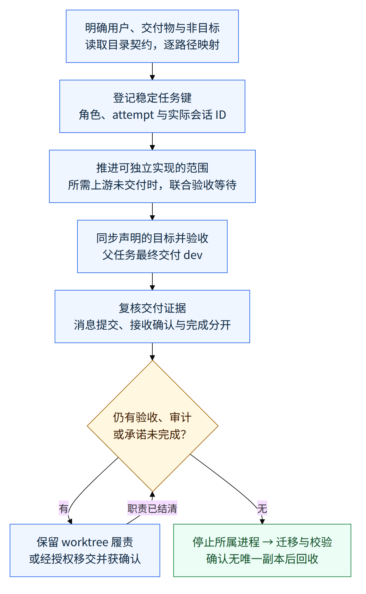

# 从理解项目到交付：让协作的每一步都有明确边界

> 中文发布示例／草稿，2026-10-28。范围为 v0.1.20 到已合并 PR #114 的
> `6fde6aadd140e70b39458d5b3dfbe0160dc8a690`。这是尚未发布版本的写作示例，
> 不包含 Issue #115 对发布写作流程本身的改动，也不替代正式 release notes。

Coding-Agent Project Template 是给项目维护者和 coding agent 使用的开发起点：
产品放在项目声明的产品树里，开发规则、经验和工具放在 `.agents/`，面向人的
说明留在根文档。它交付的是可采用、可升级的规则、skills、脚本和项目骨架，
下游仍自己决定产品是什么。模板不提供自动调度器，也不替代维护者的授权。

这次变化把已有的 Issue、worktree、消息和回收流程连起来：先确认真正要交付
什么，再安排谁在哪里做；可以开始实现的部分先推进，但验收、接收确认和清理
各自依据自己的证据。维护者因此能看出一个任务正在等什么，避免把“发送成功”、
“子 PR 已合并”或“窗口空闲”误当成全部完成。

## 先理解交付物，再决定目录与任务

v0.1.20 已有三个平面、隔离 worktree、依赖记录和输入行检查。仅有这些约束仍
不足以回答“这个项目服务谁、最终交付什么”。例如论文项目的产品是可独立构建的
论文源文件；采用模板不意味着把论文改成软件包，也不意味着统一搬迁已有测试。

现在，采用模板和处理结构性 Issue 都先明确用户、交付物、核心概念和非目标，
读取受影响目录的契约，再逐路径说明保留或迁移的内容。README 解释定位，USER
解释使用，DEV 解释扩展和维护，memory 留下决定和理由。项目自己的适配段也不能
静默覆盖目录契约；遇到冲突，要先显式解决。

## 实现可以先行，验收与交付仍有明确终点

假设一个父任务要让两个组件一起工作，而它们的接口已经固定。互不依赖的实现
可以分别推进；如果最终验收需要上游合并，执行者仍要同步目标分支并验证组合。
真实的 blocked-by 依赖继续约束派出，不能用“部分工作能开始”绕过它。

简单 Issue 仍从 dev 开始并交回 dev。需要联合验收的父任务可以声明父集成分支，
同时写清负责人、子 PR 的目标、最终 dev PR 和验收责任。子 PR 合入父分支只完成
该子任务的集成；父任务要到联合验收和最终 dev 交付完成后才算结束。

*图 1｜协作交付的核心流程示意。箭头表示责任与先后条件，不表示耗时、自动执行
或真实运行结果。图中的“等待上游”只适用于需要它的验收；没有依赖的任务继续
推进。静态图与可重建的 Mermaid 图源一同保留，窄屏读者也可按上方文字理解流程。*

身份和通信同样成为交付的一部分。一个稳定任务键连接 workspace、tab、Herdr
agent 和原生 session；重派保留任务键，分开登记角色、attempt 和实际返回的 ID。
显示名便于查找，不能代替会话地址。完整 agent 名在启动或改名前检查字符、32
字符上限和 live 唯一性，原生命名使用已核实入口，不猜测命令参数。

消息则分为三个状态：submitted 表示传输接受，acknowledged 表示目标会话明确
确认收到这条消息或对应范围，completed 表示结果已按验收标准复核。传输选用
发送方实际可用的原生能力，Herdr 是满足状态和输入行条件后的回退。一次队列
接受或后来的 idle 都不能替代接收者的确认。

| 协作环节 | v0.1.20 的基础与留下的问题 | 这次变化带来的做法 |
| --- | --- | --- |
| 定位与布局 | 已分三个平面，但目录正确仍可能交付错误的产品 | 先明确用户和交付物，再读目录契约、逐路径映射 |
| 依赖与集成 | 已记录 blocked-by，常规流程以 dev 为目标；缺少实现与验收依赖的细分 | 独立实现可先行，组合仍待同步验收；显式声明父集成分支，最终交付 dev |
| 任务身份 | worktree 和会话分开存在，名字与返回 ID 的关联不够明确 | 稳定任务键连接角色、attempt 和实际 ID，命名先检查长度与唯一性 |
| 消息送达 | 已检查输入行，但传输接受、接收确认和完成容易混为一谈 | 分开记录 submitted、acknowledged、completed，能力核实后选择传输 |
| 合并后回收 | 已有停进程、迁移和校验流程，idle 或 merged 仍可能留下验收责任 | 先结清后台验收、审计和承诺，或经授权移交并获确认，再回收 |

*表 1｜与 v0.1.20 的流程对照。比较的是规则和脚本交接文本，不是速度或成功率
测量；这些变化仍需要执行者与协调者使用现有工具落实。*

协调者在上游交付后重新评估自己认领的依赖，通知并复核下游；执行者负责本
worktree 的实现、冲突修复和证据。等待记录写清事件、责任人、关联版本或运行、
未完事项及下一步。即使 PR 已合并，只要还有后台验收或审计承诺，worktree 就
保留到职责完成，或在授权下明确移交并得到确认；之后才停止所属进程、迁移
状态与资产、校验没有唯一副本遗留并移除 worktree。

## 证据支持到哪里

历史验收记录对应 PR #114 的实现提交 `05a2b3583ce7dea1a804813585af6d54161ee1c3`。
其本地模板测试输出为 `Ran 51 tests in 8.722s`、`OK`；逐脚本 Bash 语法、setup、
diagnose、inspect-state 以及四个修改 skill 的校验均通过。它还记录了 13 个流程
场景的规范走查，包括父集成分支、发送后未确认、idle 仍有后台任务和重派命名。
这些是历史记录，场景走查不代表实际执行过跨会话消息、真实合并或回收。

本轮在上述合并提交基础上，对 Issue #115 的文档候选重新执行本地检查，
`python3 -m unittest discover -s .agents/tests -p 'test_template_*.py'` 输出
`Ran 51 tests in 9.106s`、`OK`。所有现有 shell 脚本的 `bash -n`、worktree setup、
环境诊断、状态检查和 release skill 校验也均退出 0；诊断确认 PUBLIC、默认分支
dev、worktree marker 正确，状态检查显示 `docker: none`。这轮结果验证脚本
接缝与文档交付，既不是重新执行跨会话端到端实验，也不是对未来 tag 的验收。
正式发布时仍须对最终选定的版本运行适用检查。

这些证据能支持“规则、交接文本及既有脚本接缝保持一致”的结论，不能证明团队
效率提升、任何 provider 上的普遍送达保证，或无人监督的自动协调。原生消息
能力受客户端、版本和权限影响；一次 Codex 首回合 no-rollout 观察也不能推广为
所有版本的限制。本次没有新增消息服务、调度器或产品运行能力。

## 怎样获取和复用

想审阅这次变化，可以使用文末固定的源代码快照及完整比较；它们不随 dev 继续
开发而变化。已有项目的正式升级仍以已发布 tag 为目标，按自己的 template-upgrade
流程操作；本草稿不是新版本标识，不应把示例版本写进下游 registry。

### Upgrading a project from v0.1.20

以下是本草稿对未来正式升级所需人工工作的说明，当前没有新 tag 可供升级。

1. 新版本正式发布后，运行项目已有的 `upgrade-template.sh` 并审阅其计划、冲突和
   手动项。共享规则更新范围涉及 template-adoption、issue-workflow、
   agent-communication、worktree-lifecycle 及相关 memory、knowledge 和交接脚本；
   保留本项目的适配段。不要用本示例替换项目自己的 release notes。
2. 核对已有适配是否仍假定所有任务一律以 dev 为子 PR 目标、队列接受等于确认，
   或合并/idle 即可回收；按新的责任边界修订。需要父集成分支时显式登记，否则
   继续使用默认 dev。检查项目定位、受影响目录契约和路径映射，不强制移动测试。
3. 在下一次实际派出与交接时，记录任务键、角色、attempt 和返回的会话 ID，核实
   可用的原生命名与消息能力；检查后台验收和未完承诺的责任人，再决定回收。
   当前会话、其他项目和 provider 配置不因阅读此示例而自动改变。

下一步是审阅这些规则在各项目中的适配，再选择正式发布候选并验收。发布说明
应随最终候选更新证据与获取方式；这份草稿只展示已合并变化的叙事，不宣布新的
tag、下游升级结果或未测量的收益。

## 参考资料

- [前版 v0.1.20](https://github.com/a-green-hand-jack/coding-agent-project-template/releases/tag/v0.1.20)；
  [前版固定代码](https://github.com/a-green-hand-jack/coding-agent-project-template/tree/822a749b6055b52cab88566cc3f51d4494e0a53e)。
- [Issue #113：项目定位与协调流程](https://github.com/a-green-hand-jack/coding-agent-project-template/issues/113)；
  [PR #114：实现、历史验收和场景边界](https://github.com/a-green-hand-jack/coding-agent-project-template/pull/114)。
- [合并后固定代码](https://github.com/a-green-hand-jack/coding-agent-project-template/tree/6fde6aadd140e70b39458d5b3dfbe0160dc8a690)；
  [从前版到该提交的完整比较](https://github.com/a-green-hand-jack/coding-agent-project-template/compare/822a749b6055b52cab88566cc3f51d4494e0a53e...6fde6aadd140e70b39458d5b3dfbe0160dc8a690)。
- [Issue #115：本发布示例与写作流程](https://github.com/a-green-hand-jack/coding-agent-project-template/issues/115)；
  [流程图源](.github/release-examples/coordination-flow.mmd)。
